# 🤖 Billionaire Strategy Multi-Brain Neural Trading Engine

> **A single-file Python day-trading robot for Alpaca, with a frozen-foundation neural timing brain, a fleet of specialist brains that must agree before capital moves, and a real-time operations dashboard.**

Every buy order has to survive a committee. A timing brain scores it, a day-trade brain checks the chart, a risk sentinel checks the book, a correlation guard checks the sector, a manager brain casts the deciding vote — and a pre-trade backtest replays the robot's own entry and exit rules on that symbol's recent history before a dollar is committed.

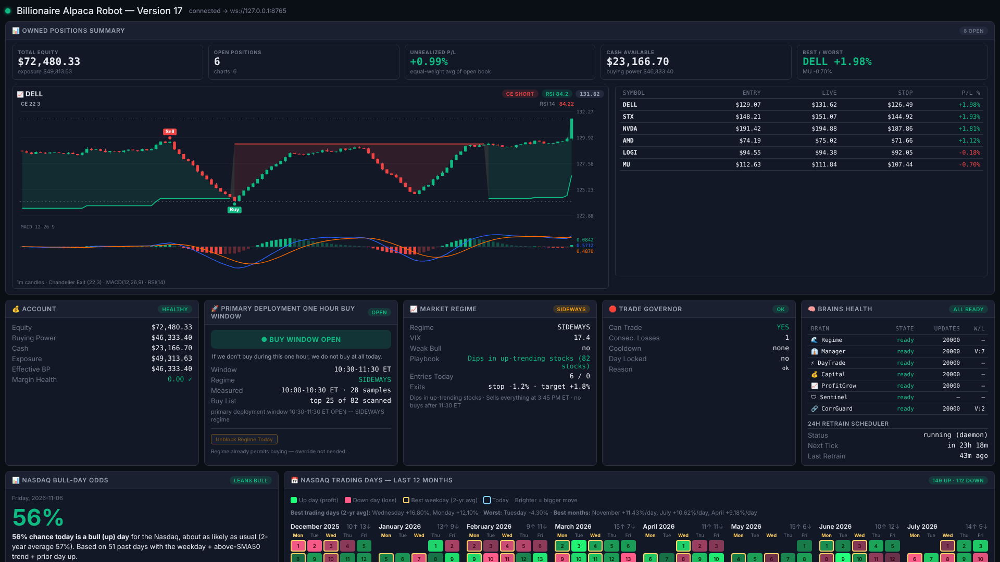

<sub>*Screenshots throughout this README are captured from the real `alpaca_dashboard_v18.html` running against a simulated market feed. The layout, indicators, and computed values are genuine; the account balances, symbols, and P&L are sample data, not a trading record.*</sub>

<sub>[See the entire dashboard in one tall image →](docs/images/01-dashboard-full.png)</sub>

---

## 📑 Contents

- [What it does](#-what-it-does)
- [Requirements](#-requirements)
- [Install](#-install)
- [Run it](#-run-it)
- [The dashboard, tile by tile](#-the-dashboard-tile-by-tile)
  - [Primary Deployment One Hour Buy Window](#primary-deployment-one-hour-buy-window)
- [The features that actually move the needle](#-the-features-that-actually-move-the-needle)
- [Configuration reference](#-configuration-reference)
- [Troubleshooting](#-troubleshooting)
- [Risk disclaimer](#-risk-disclaimer)

---

## 🎯 What it does

| | |
|---|---|
| **Broker** | Alpaca (paper or live) — market orders only, no resting limit orders |
| **Universe** | 82 technology, computer and consumer-electronics brands (NASDAQ + NYSE), mid cap and up — scanned and ranked every cycle, **top 25** eligible to buy |
| **Buy window** | **10:30–11:30 AM Eastern only**, and only when the latched regime is bullish or sideways |
| **Entries** | Up to **25 positions in a single pass**, cash split equally. Bull days use the **same setup as sideways** (20-day dip, 2% stop, 3% target) |
| **Entry signal** | `dip_20d` — price ≥1% off its 3-hour high and turning up on the current bar, in a name with positive 20-day momentum |
| **Regimes that trade** | Bull and sideways only, using the **identical** rule. Bear and panic buy nothing |
| **Exit signal** | Playbook 2% stop / 3% target, plus the chandelier ATR trail, profit-monitor giveback, round-trip rescue, hard stop and the 3:45pm sweep — none of them gated by the buy window |
| **Hold time** | Minutes, not days — most winners are 5-minute moves; a runner is allowed up to an hour while RSI stays elevated |
| **Overnight** | Anything green by a penny is sold before the bell; losers may carry up to two trading days |
| **Data** | Alpaca IEX daily bars (fast path), yfinance for intraday 1m/5m and fallback |
| **Dashboard** | WebSocket on `127.0.0.1:8765`, 1 Hz, 27 live tiles |

---

## 🧰 Requirements

| | |
|---|---|
| OS | Ubuntu Linux 24.04 (any modern Linux works) |
| Python | Anaconda Python 3 (`base` environment), 3.11 – 3.13 |
| RAM | 16 GB recommended (TensorFlow pretraining is the peak) |
| Disk | 20 GB free for models, caches, and the SQLite trade database |
| GPU | Optional — NVIDIA CUDA is auto-detected and the TensorFlow variant is swapped to match |
| Account | Alpaca API key + secret (start with paper) |

---

## 📦 Install

### 1. System packages and TA-Lib

TA-Lib is the one dependency pip cannot install on its own — it needs the C library first.

```bash
sudo apt update
sudo apt install -y build-essential wget git
```

```bash
# Build the TA-Lib C library
cd /tmp
wget https://github.com/ta-lib/ta-lib/releases/download/v0.6.4/ta-lib-0.6.4-src.tar.gz
tar -xzf ta-lib-0.6.4-src.tar.gz
cd ta-lib-0.6.4
./configure --prefix=/usr
make
sudo make install
sudo ldconfig
```

### 2. Clone the repo

```bash
git clone https://github.com/CodeProSpecialist/Billionaire-Strategy-Multi-Brain-Neural-Trading-Engine.git
cd Billionaire-Strategy-Multi-Brain-Neural-Trading-Engine
```

### 3. Anaconda

The robot runs in the **Anaconda `base` environment** — no virtual environment needed. If you do not already have Anaconda, download the Linux installer from [anaconda.com/download](https://www.anaconda.com/download) and run it:

```bash
bash ~/Downloads/Anaconda3-*-Linux-x86_64.sh
```

> ✅ **At the end of the installer it asks whether to automatically initialize conda / update your shell profile so the `base` environment activates every time you open a terminal. Answer `yes`.** That is what makes `base` active by default, so the robot and its packages are always on the same Python. If you answer `no`, you have to run `conda activate base` by hand in every new terminal before starting the robot, and a `cron` job or desktop launcher will silently use the system Python instead and fail to find the packages.

If you already installed Anaconda and answered `no`, you can turn it on afterwards:

```bash
conda init bash
conda config --set auto_activate_base true
```

Close and reopen the terminal — the prompt should now start with `(base)`.

### 4. Python packages

Install into `base`:

```bash
conda activate base
pip install --upgrade pip
pip install alpaca-trade-api alpaca-py pytz numpy TA-Lib yfinance SQLAlchemy \
            ratelimit pandas-market-calendars pandas schedule websockets requests \
            tensorflow backtrader
```

The robot also carries a **dependency bootstrap** at the top of the file: on startup it runs `pip list --format=freeze`, compares against its required set, and silently installs anything missing. The manual install above just saves you the first-run wait.

### 5. API keys

```bash
export APCA_API_KEY_ID="your_key_here"
export APCA_API_SECRET_KEY="your_secret_here"
export APCA_API_BASE_URL="https://paper-api.alpaca.markets"   # paper trading
```

Put these in `~/.bashrc` so they survive a reboot. **Start on paper.** Switch the base URL to `https://api.alpaca.markets` only after you have watched it trade for a while.

### 6. Optional environment variables

| Variable | Default | Purpose |
|---|---|---|
| `BOT_DASHBOARD_HOST` | `127.0.0.1` | Dashboard WebSocket bind address |
| `BOT_DASHBOARD_PORT` | `8765` | Dashboard WebSocket port |
| `BOT_DASHBOARD_TOKEN` | *(none)* | Shared secret; the dashboard must pass `?token=` to connect |
| `_NO_COLOR` | *(unset)* | Set to `1` to strip ANSI color from terminal output |

---

## ▶️ Run it

```bash
conda activate base
python3 billionaire_strategy_buy_lowest_price_stock_market_robot_v18.py
```

Then open the dashboard — it is a plain file, no web server needed:

```bash
xdg-open alpaca_dashboard_v18.html
```

If the dashboard is on another machine, or you changed the port:

```
alpaca_dashboard_v18.html?ws=ws://192.168.1.40:8765
alpaca_dashboard_v18.html?wsPort=8765&token=YOUR_TOKEN
```

**First run takes a while.** The brains pretrain before the first trade: Brain B (risk) and Brain D (portfolio) on 20,000 synthetic snapshots each, then the timing brain's head on real historical sequences, then Brain F (bullish picker). On CPU this is tens of minutes. It happens once — the models are cached on disk and reloaded after that.

> ⚠️ The dashboard listens on port **8765**. If another program on the host already uses that port, set `BOT_DASHBOARD_PORT` to something else.

---

## 🖥️ The dashboard, tile by tile

27 tiles, all driven by one 1 Hz WebSocket snapshot. Every number you see below is computed server-side in the bot and pushed to the browser — nothing is calculated in the page except the drawing.

### Owned Positions Summary

Equity, exposure, open count, unrealized P&L, and a best/worst line, with the lead position's full chart beside a sortable entry/live/stop/P&L table. This is the tile to glance at if you only have five seconds.

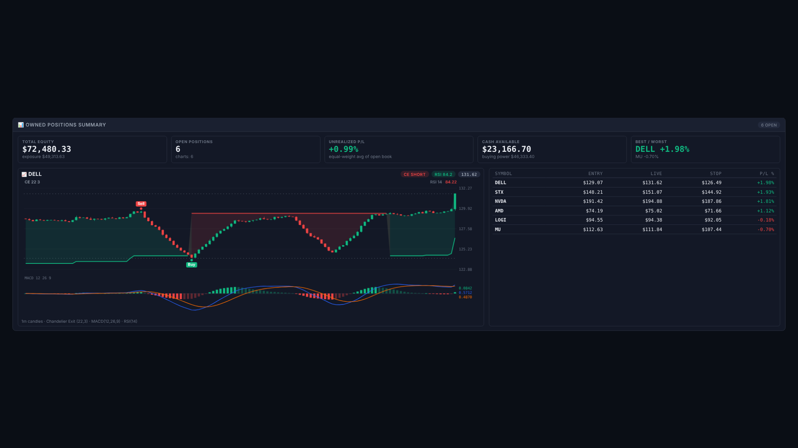

### Position Charts — 1m candles, Chandelier Exit, MACD, RSI

The heart of the UI, and the tile that mirrors a TradingView layout. Each owned position gets live 1-minute candlesticks with the Chandelier Exit (22,3) step line drawn in its active direction, **Buy** and **Sell** flags printed at every CE flip, the MACD(12,26,9) histogram with both lines underneath, and the live RSI(14) read in the header. Symbols the robot is watching but does not own are rendered too, tagged `WATCHING TO BUY`.

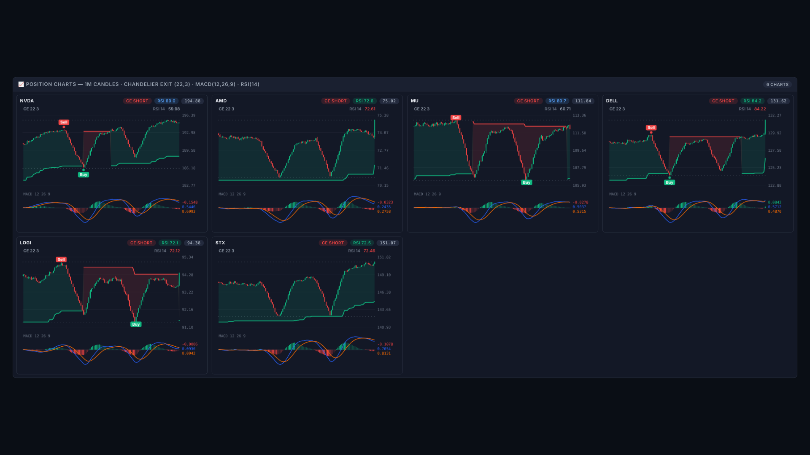

### Primary Deployment One Hour Buy Window

The one tile that answers "why isn't it buying?" at a glance. Orders are placed **only** between **10:30 and 11:30 AM Eastern**, and only when the day's latched regime is bullish or sideways — a bearish, panicked, or unmeasurable regime buys nothing at all unless the operator explicitly unblocks it for that day (see below). **If the robot doesn't buy during that one hour, it does not buy at all that day** — there is no later window and no catch-up.

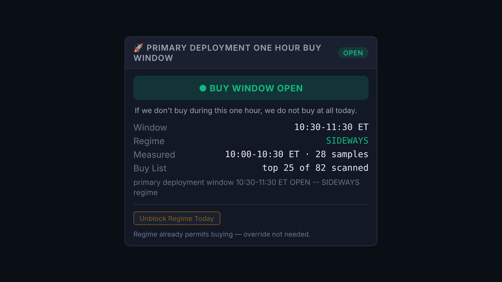

The lamp has four states on purpose:

| Lamp | Meaning |
|---|---|
| 🟢 **BUY WINDOW OPEN** | Inside the hour *and* the regime permits — an order can be placed right now |
| 🟠 **WINDOW OPEN — REGIME BLOCKED** | The hour is running, but the regime vetoed the day |
| 🔵 **BUY WINDOW OPEN — REGIME OVERRIDDEN** | The hour is running and the regime vetoed it, but the operator waived the veto for today |
| ⚪ **WAITING / CLOSED / MEASURING** | Outside the hour, or sampling the regime ahead of it |

The amber state matters: without it, a bearish day and a hung robot look identical from across the room. The blue state matters for the same reason in reverse — an overridden bear day must never be mistaken for a regime the robot actually liked.

#### Unblocking the regime for one day

When the regime blocks the day, the tile offers a way out. The button reads **Unblock Regime Today**, and the tile turns amber to show the hour is running with nothing allowed to fire:

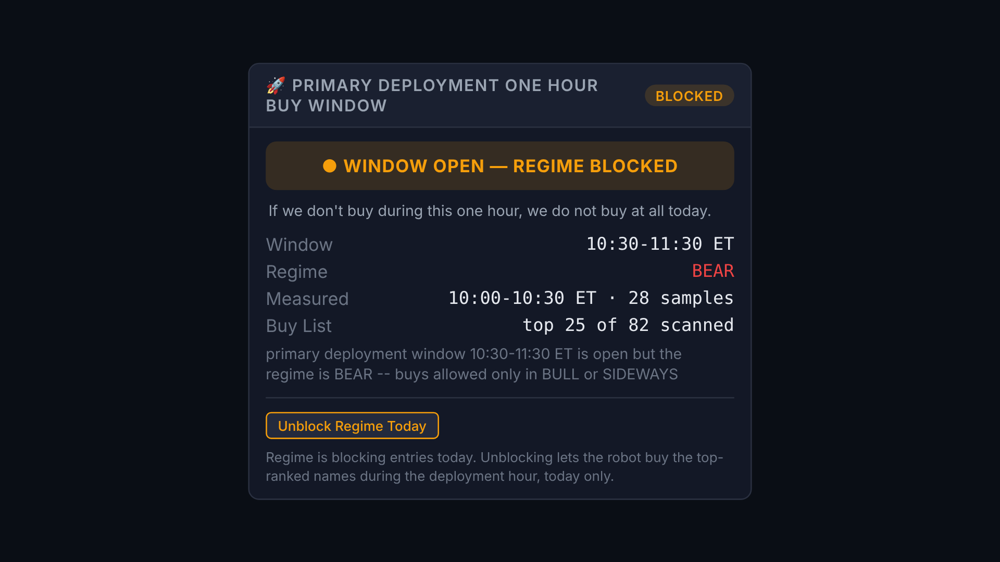

Pressing it (behind a confirmation prompt that names the day's regime) waives the regime veto and lets the robot buy the top-ranked names during the deployment hour. The lamp turns blue, the tag reads `OVERRIDE`, and the button flips to **Re-block Regime**:

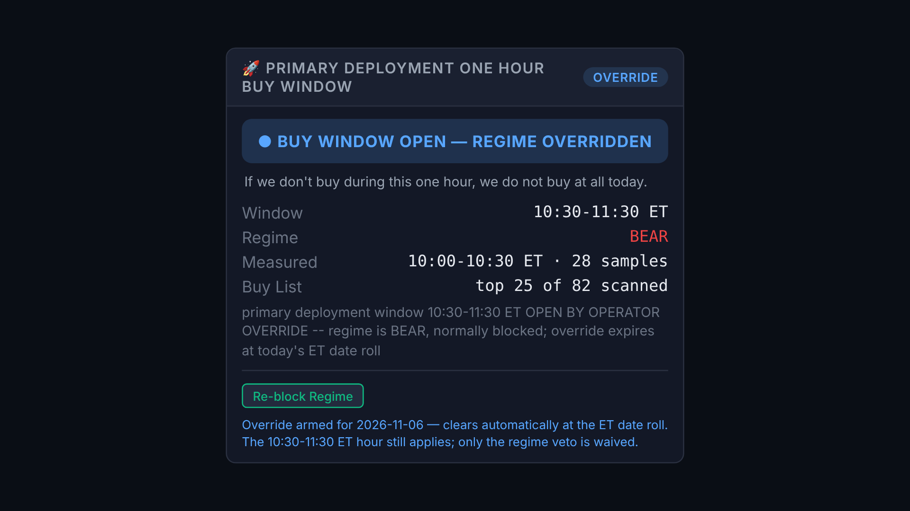

The override is deliberately narrow:

- It waives **only** the regime test. The 10:30–11:30 ET window still governs completely — arming it at 09:45 or at noon buys nothing.
- It is keyed by **Eastern date** and expires on its own at the date roll. There is no way to leave it armed overnight by forgetting about it.
- The trade governor, the blacklists, the exposure caps, the per-symbol brains and **every exit path** are untouched.
- Each press is logged at `WARNING` and posted to the Brain Trading Floor as a `USER` instruction, so the days you overrode are on the record.

Button state is driven by the server snapshot on every tick rather than by local browser state, so a page reload or a second browser tab always shows the real latch. When the regime already permits buying, the button greys out — there is nothing to unblock.

> **This removes a safety gate.** A bearish or panicked regime is precisely the condition the window was built to sit out. Treat the override as an occasional deliberate act, not a routine one.

**Regime is measured, not glanced at.** From **10:00 to 10:30 ET** the robot samples the SPY + VIX regime repeatedly and, at 10:30, latches the **majority verdict** for the rest of the session. A split decision breaks toward the more conservative regime. The latch is frozen — the robot cannot talk itself into buying at 11:15 because SPY twitched across its 20-day SMA.

> **Backtest caveat:** the playbook's published +0.11%/trade figure was measured on the **Nasdaq-100**. The live universe is now the 82-name tech+electronics list, which that backtest does not cover — treat the figure as historical context for a different universe, not as a forecast for this one. Set `PLAYBOOK_NDX_UNIVERSE_SOURCE = 'ndx100'` to return to the backtested configuration.

**Wide scan, narrow buy list.** The whole universe is measured and scored every cycle — nothing is skipped — but only the **top 25** are eligible to be bought. Ranking uses the operator composite (relative dollar volume, 20-day momentum, market-cap proxy), z-scored across the candidates so no one factor's raw units dominate, and is applied *after* the liquidity and momentum filters so the 25 slots go to names that already qualify. A name ranked 26th is not bought even with a perfect setup, and the leaders will tend to recur day to day — that is what ranking does.

**The rules, in order.** Every buy must clear all of these, in this sequence:

| # | Gate | Rule |
|---|---|---|
| 1 | **Clock** | 10:30–11:30 AM Eastern. Outside it, no order is placed — checked at the top of the cycle *and* again immediately before `submit_order` |
| 2 | **Regime** | Latched at 10:30 from samples taken 10:00–10:30. Bull or sideways trades; bear, panic and unmeasured do not |
| 3 | **Universe** | 82 technology, computer and consumer-electronics names (NASDAQ + NYSE), mid cap and up |
| 4 | **Liquidity** | ≥ $20M average daily dollar volume |
| 5 | **Momentum** | Positive 20-day momentum |
| 6 | **Shortlist** | Ranked by dollar volume + 20-day momentum + market-cap proxy; only the **top 25** remain eligible |
| 7 | **Setup** | `dip_20d` must fire: ≥1% off the 3-hour high and turning up on the current bar |
| 8 | **Daily cap** | At most 25 positions for the day, cash split equally |

**Per regime:**

| Regime | Setup | Stop | Target | Max/day |
|---|---|---|---|---|
| **Bull** | `dip_20d` | 2% | 3% | 25 |
| **Sideways** | `dip_20d` | 2% | 3% | 25 |
| **Bear** | `gap_reversal` | 2% | 3% | 5 — *configured but dormant; the window gate ends the cycle before the playbook is consulted* |
| **Panic / unknown** | — | — | — | 0 |

Bull and sideways are deliberately identical: a bull day buys exactly the way a sideways day does. The regime decides only **whether** the day trades, not **how**.

> **A consequence worth knowing:** `dip_20d` needs a pullback of at least 1% off the 3-hour high. On a strong bull morning names often grind upward without pulling back that far — which is exactly when the setup will *not* fire. Bull days may therefore produce *fewer* fills than sideways days, not more.

The window is an **entry** gate only. Stops, the profit monitor, the chandelier trail, scale-outs, and the close sweeps are never gated by it — an open position can always leave, at any hour, in any regime. The check is enforced twice: once at the top of the buy cycle, and again immediately before `submit_order`, because a scan can run for minutes and the window can close underneath it.

### Account · Market Regime · Trade Governor · Brains Health

The header row. Account carries equity, buying power, cash, exposure, effective BP, and margin health. Market Regime shows the live bull/bear/sideways/panic call with VIX, the weak-bull downgrade flag, and the playbook that regime selects. Trade Governor shows whether new entries are permitted at all, the consecutive-loss count, cooldown, and daily profit lock. Brains Health is the one-line status of all seven specialist brains plus the 24-hour retrain scheduler.

| | |
|---|---|
| 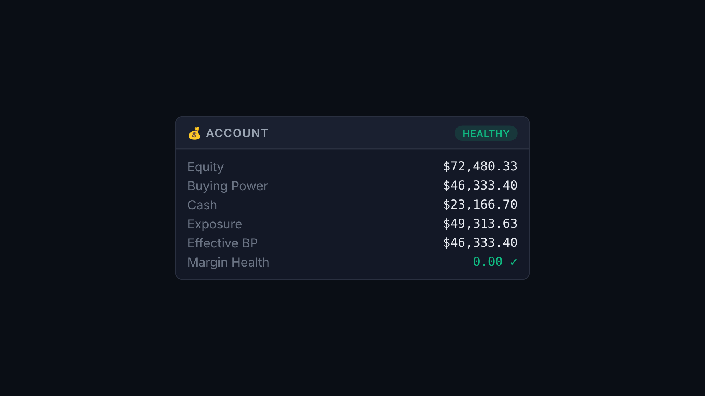 | 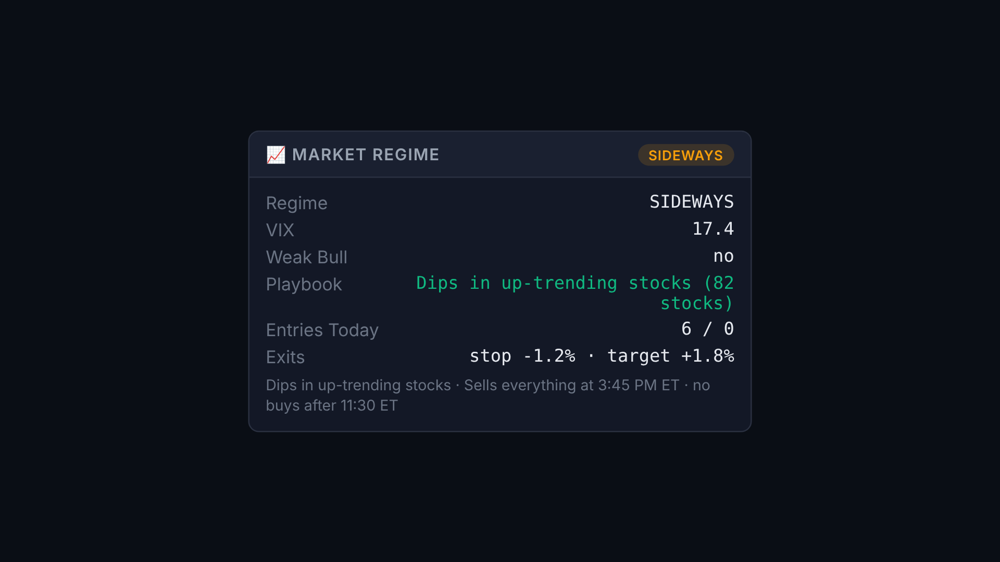 |
| 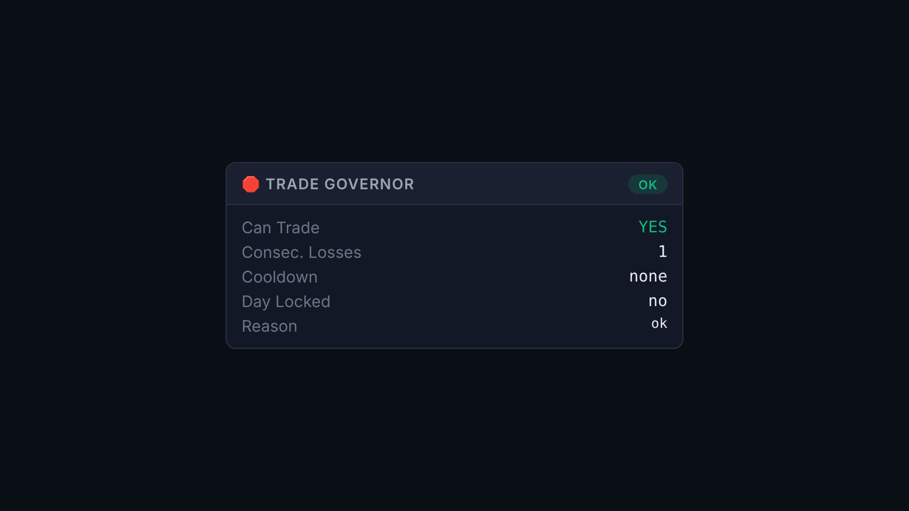 | 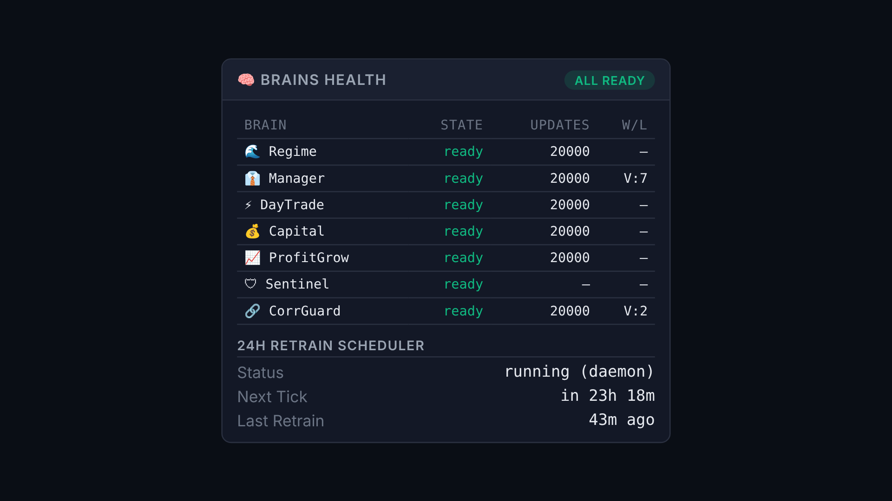 |

### Nasdaq Bull-Day Odds

The probability that today closes green for the Nasdaq, built from trailing 12-month QQQ closes, broken out by weekday, with the live intraday percentage and an explicit reliability warning. The weekday edge is small and the tile says so — it is a tie-breaker, not a signal.

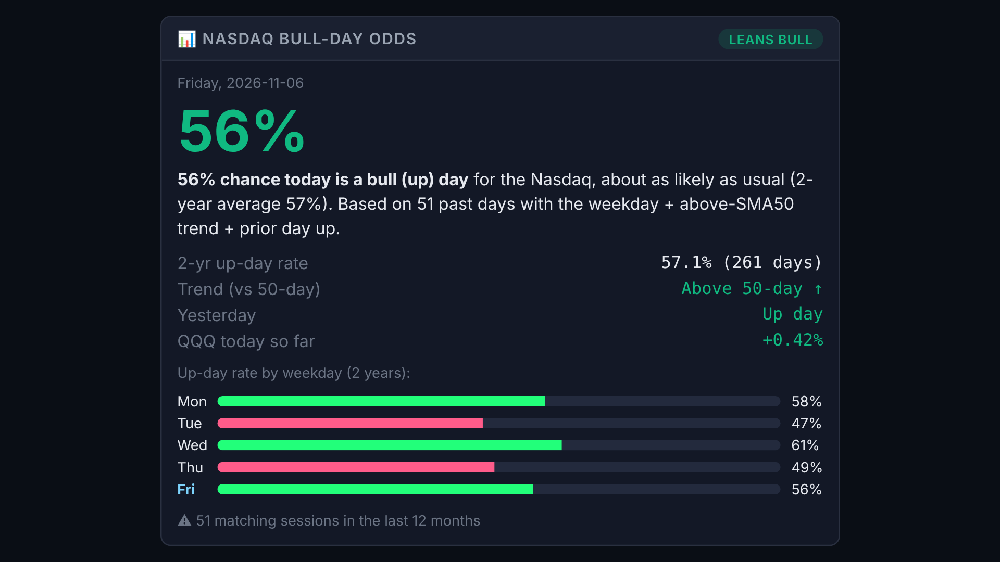

### Nasdaq Trading Days — Last 12 Months

Twelve months of trading days as a heat calendar. Brightness is the size of the move, green is up, red is down, the best two weekdays by two-year average return are highlighted, and today is ringed. It makes seasonal and weekday patterns visible at a glance instead of buried in a backtest log.

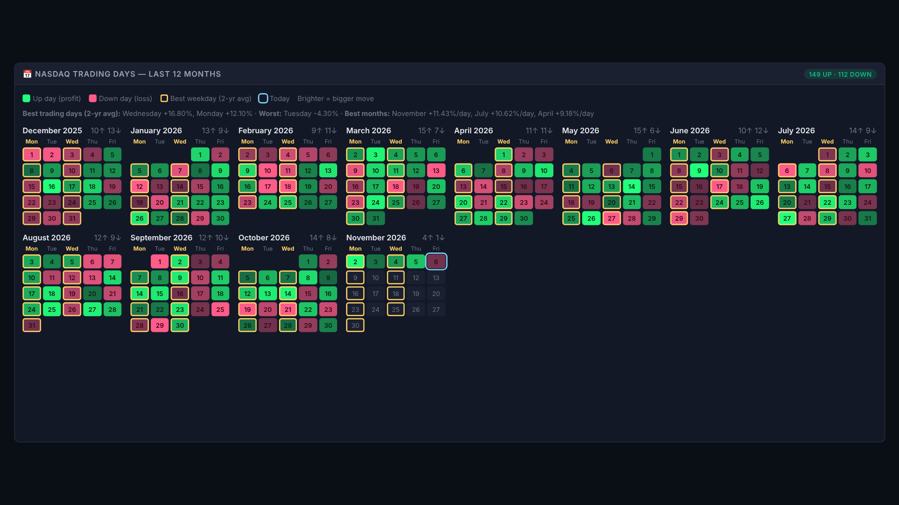

### Live Positions · Profit Monitor · Recent Trades

Per-position entry, live price, gain, and chandelier stop. The Profit Monitor tracks peak price and whether the trailing logic has **armed**, **touched** profit (sub-arm but printed a gain — a round-trip rescue candidate), or is still watching. Recent Trades is the last 25 fills straight from the SQLite trade history.

| | | |
|---|---|---|
| 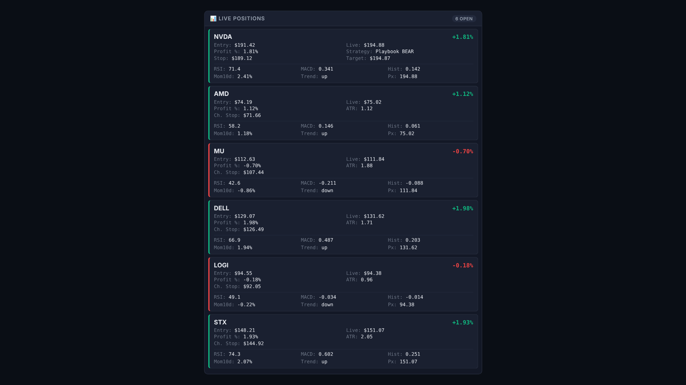 | 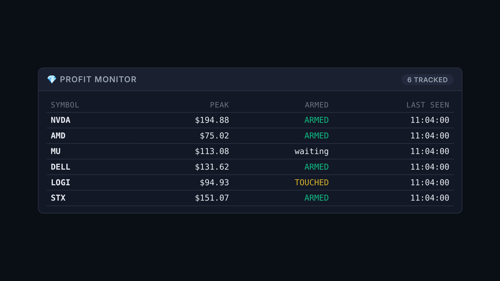 | 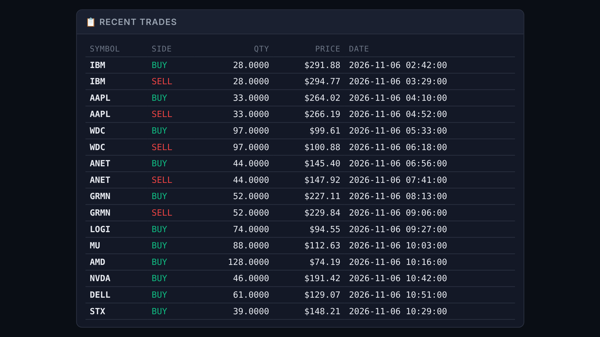 |

### 72h Auto Blacklist · Permanent Blacklist · Muted

Three layers of "do not touch this symbol." A losing close auto-blacklists for 72 hours. The permanent list is yours to curate. Mute is statistical: once a symbol has 5+ trades with negative P&L and a win rate under 30%, it goes quiet for 24 hours. All three are editable from the dashboard.

| | | |
|---|---|---|
| 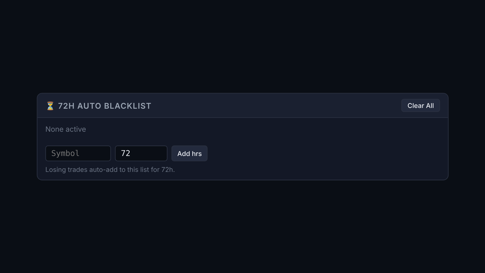 | 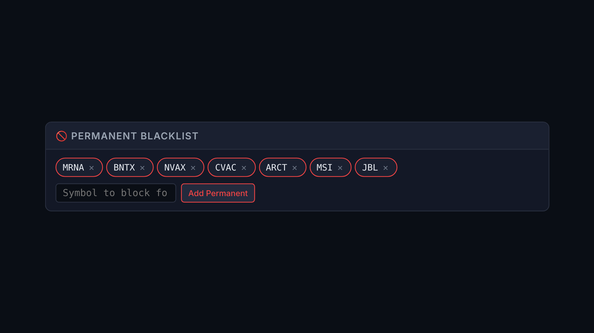 | 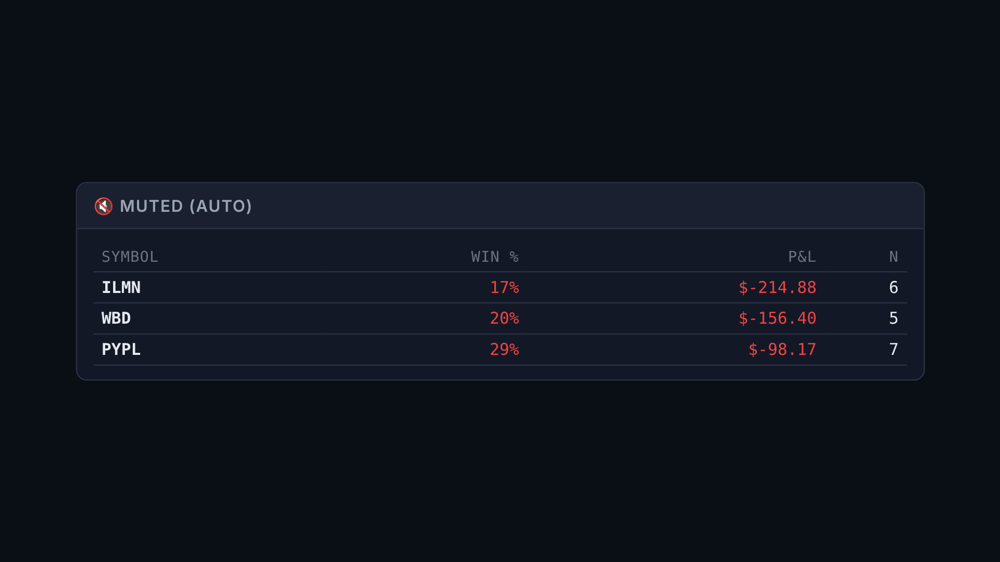 |

### Daytrade Brain — Symbol Scans

Every scanned symbol with price, RSI, MACD histogram, momentum, trend direction, the chandelier level, and the day-trade brain's win probability with how many samples back it.

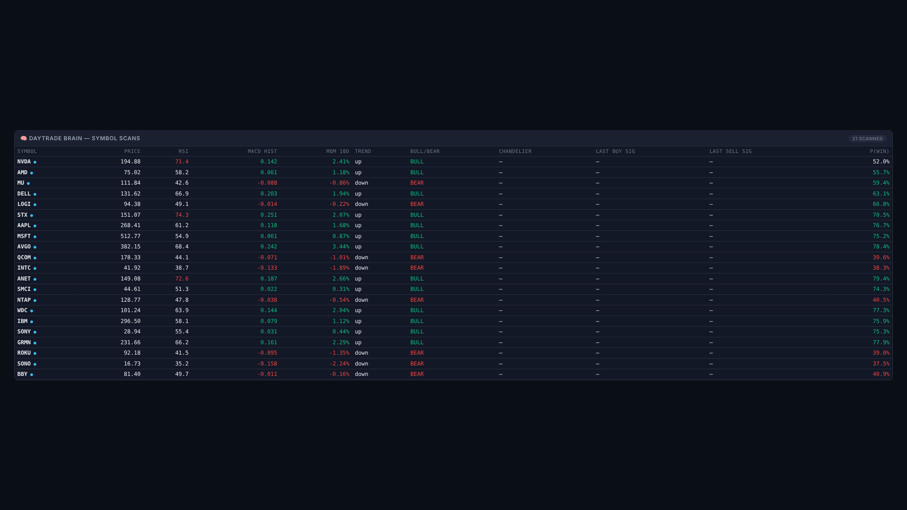

### Monitored Symbols

The scanner's live watchlist with the full indicator set, cached so the 1 Hz broadcast stays cheap.

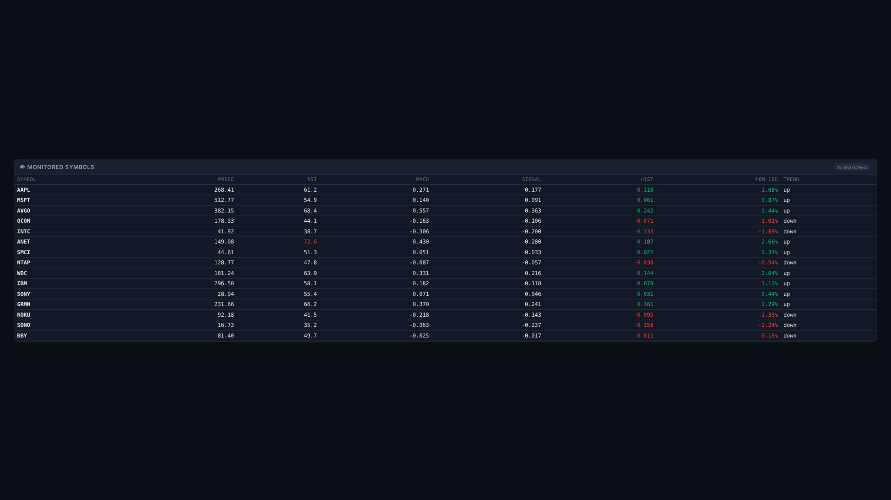

### Profit Monitor Daytrade Tile

Per-position cards: quantity, entry, current, peak, dollar and percent P&L, and sector. Green border for a winner, red for a loser, so a losing book is obvious from across the room.

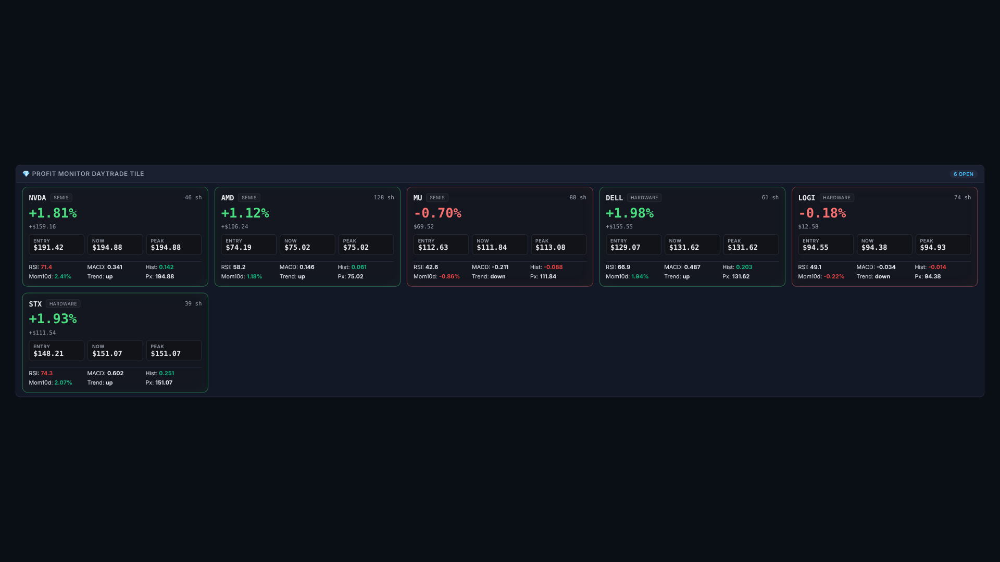

### Brain Suite

The seven specialist brains as cards — volatility regime, capital allocator, profit growth, risk sentinel, correlation guard, day-trade brain, chandelier brain — each with its trained/cold state, its current recommendation, and its update count.

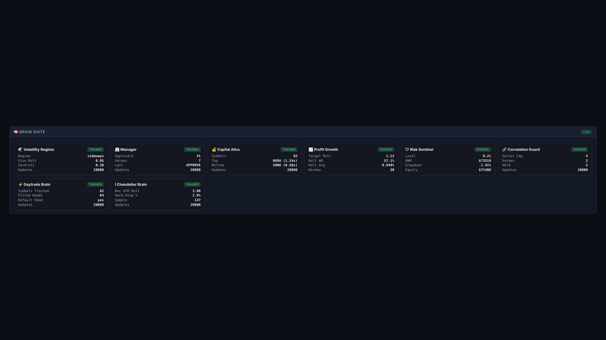

### Timing Brain — Frozen Foundation

The neural timing brain's status: foundation layer frozen with a SHA so you can verify it has not drifted, trainable head parameter count, head version, stored sample count, buy threshold, and the last retrain report — accepted or rejected, with win rate, Sharpe, validation loss, max drawdown, and weight drift.

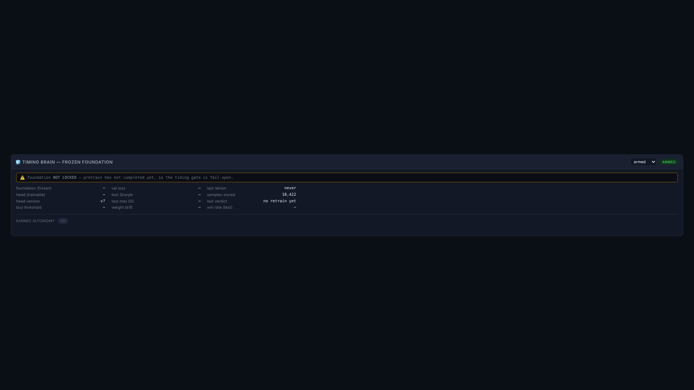

### Trade Decision Transcript

The desks arguing, in order, in plain English. Every call, observation, approval, and veto for every candidate, timestamped and attributed to the brain that said it.

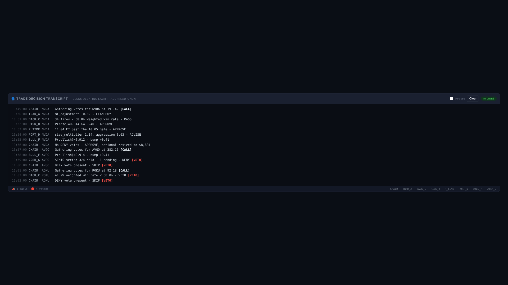

### Brain Room — Trading Floor

The robot's memory, and your command line into it. Losing closes post lessons, winning closes post observations, retrains post training notes. You type commands back: `status`, `pause`, `resume`, `sell_all`, `blacklist SOUN 8h`, `unblacklist`, `clear`, `help`.

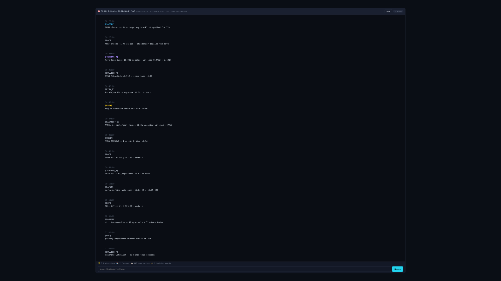

### Composite Grade — Ranking, and Buy Orders Placed

Every symbol scored this scan, with the grade broken into its components: brain probability, momentum across 24h/10d/20d/90d, weekday favorability, and prior trade history on that symbol. The second tile freezes the grade as it stood at the moment each buy actually filled — which is what lets you check later whether the grade meant anything.

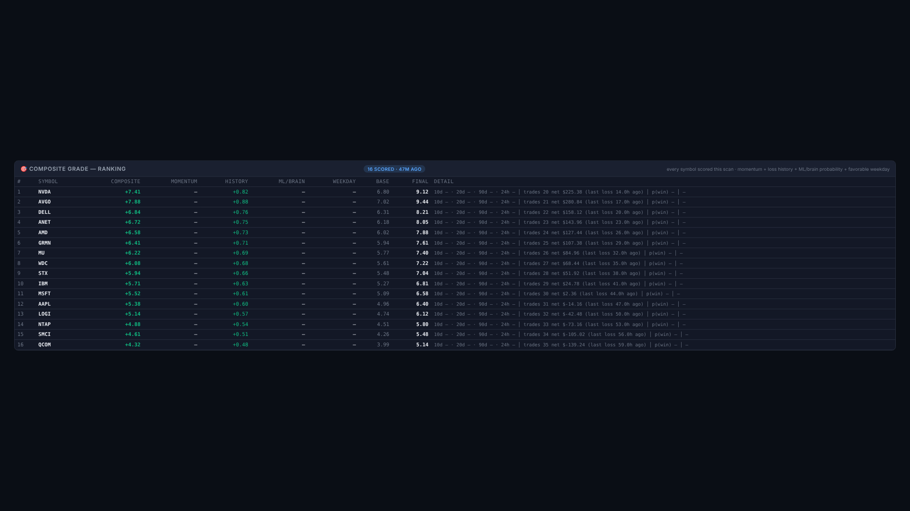

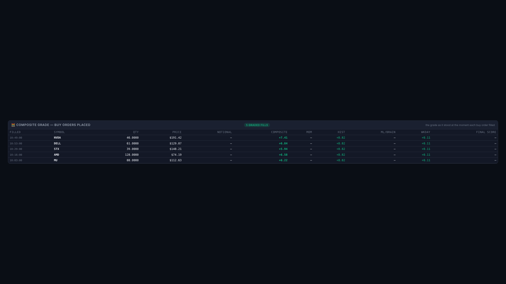

### Decision Log

One row per candidate, with the full reason stack from every gate that touched it. When the robot does not buy, this tile tells you exactly which gate stopped it.

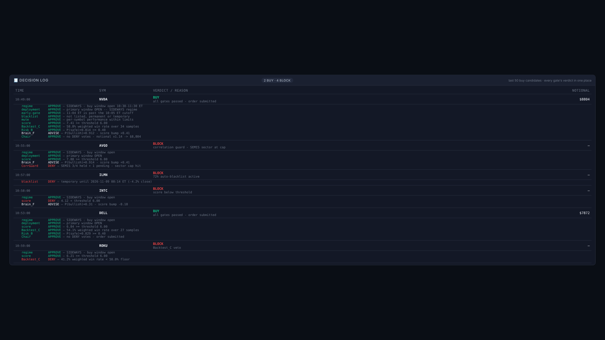

### Trade Intelligence

Logged, completed, and open trades; rolling 30-day win rate and average return; model calibration; and the best and worst symbols with their position-size multipliers.

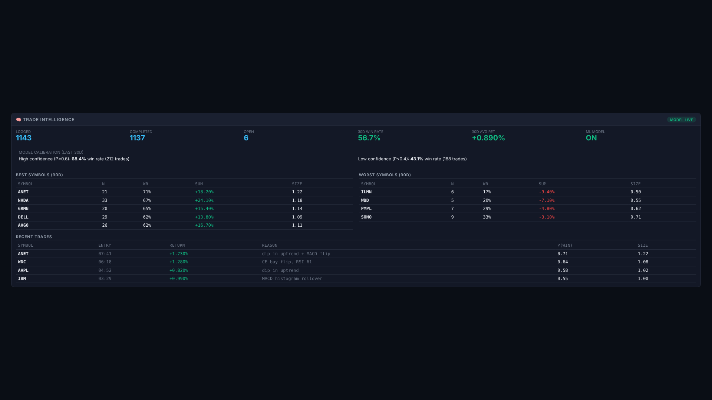

### Settings

Roughly thirty live knobs — manager strictness, chandelier mode and ATR multiple, backtest brain thresholds, Brain B/D/F modes, cooldowns, profit lock, mute thresholds, screener options, playbook toggles. Changes batch and apply on **Save All** with no restart.

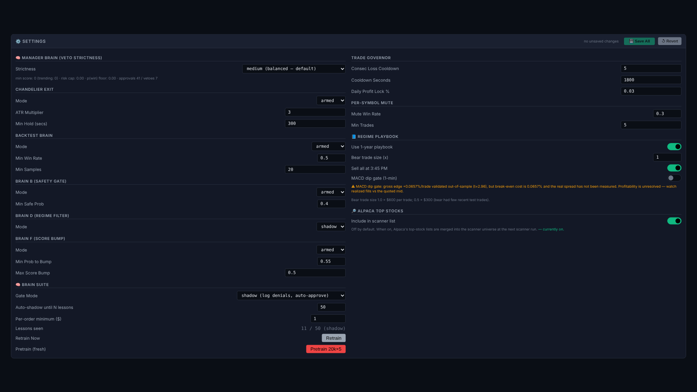

### Robot Control

Pause new entries, resume, sell everything at market, or emergency stop (pause plus liquidate). Both destructive buttons confirm first.

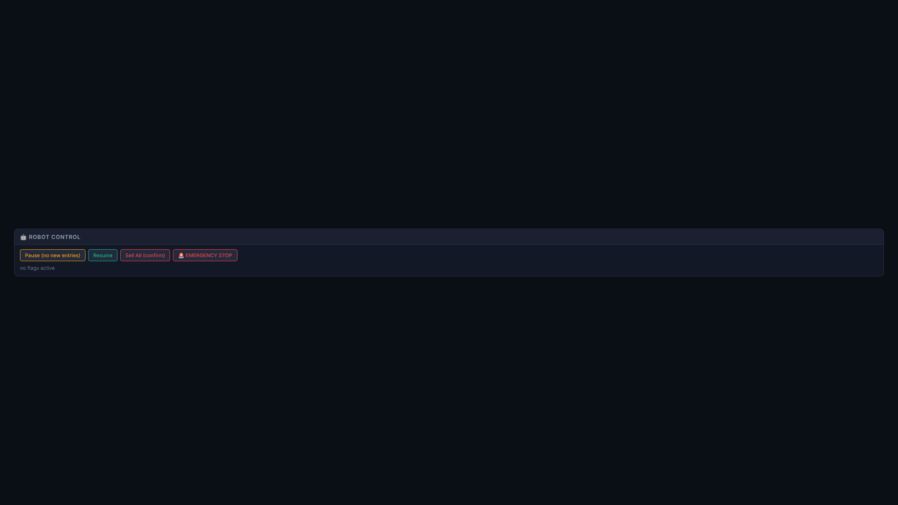

---

## 💡 The features that actually move the needle

A lot of this robot is instrumentation. These are the parts that change outcomes.

### 1. The round-trip rescue — the single highest-value fix

The profit monitor used to do nothing until a position crossed +0.5%. A trade that ran to +0.35% and reversed was left to the hard stop, and a small winner became a real loser. Now state is seeded on the **first tick**: peak price is tracked from the start, a `touched_profit` flag latches at +0.2%, and if a position that touched profit falls back to breakeven it exits immediately.

**Why it matters:** giving back a gain is the most common way a day-trading bot bleeds. This turns a category of losses into scratches. Watch it on the Profit Monitor tile — the yellow `TOUCHED` state is this rule arming.

### 2. First-reversing-bar MACD entry, not a confirmed cross

Waiting for a confirmed MACD cross means entering after the move has already extended. This robot triggers on the first bar where the histogram turns up out of the red trough, paired with the Chandelier Exit direction flip. Noisier, earlier, and the entry is nearer the bottom of the dip.

**Why it matters:** for a 5-minute pop, three bars of confirmation is the whole trade.

### 3. Pre-trade backtest on the symbol in front of you

Before any buy, the robot replays its own entry and exit rules on that symbol's recent history — 120 days and 5 days — and vetoes if the regime-weighted win rate falls below 50%. It abstains rather than guessing when there are fewer than 20 samples.

**Why it matters:** it is the difference between "this setup looks good" and "this setup has actually worked on this symbol."

### 4. The early-morning gate

No new entries before 10:05 ET unless the candidate is both below yesterday's close and down at least 2%. The first 35 minutes are thin, volatile, and full of fakeouts; this restricts early buying to genuine overnight dislocations.

**Why it matters:** it removes a whole class of trades that look like momentum at 9:40 and are reversion by 9:55.

### 5. Chandelier ATR trail + bad-news stop tightening

The chandelier stop sits between the deep hard stop and the profit monitor, ratcheting up only, never down. When rolling negative news sentiment on an owned position crosses the threshold, the stop immediately tightens to 0.3% under current price.

**Why it matters:** it defends capital against the single-headline drop that technicals cannot see coming.

### 6. Three layers of "stop trading this"

The 72-hour auto blacklist after a losing close, the statistical mute at 5+ trades with sub-30% win rate, and the Trade Governor's consecutive-loss cooldown and daily profit lock.

**Why it matters:** most bad days are one bad symbol traded repeatedly, or a losing streak the operator did not stop. These stop it without you watching.

### 7. Market orders, always

No resting limit orders. During peak intensity an unfilled limit is a missed trade, and a missed exit is worse than a few cents of slippage.

**Why it matters:** fill certainty beats fill price on a 5-minute hold.

### 8. The frozen foundation

The timing brain's foundation layer is hand-weighted, frozen, and SHA-verified. Only the head retrains. Retrains are evaluated and **rejected** if validation loss, win rate, or drawdown degrade.

**Why it matters:** a model that silently drifts is worse than no model, because you keep trusting it. The Timing Brain tile shows you the SHA and the accept/reject verdict every time.

### 9. The Decision Log

Every candidate, every gate, every reason. When the robot has a quiet day, this is where you find out whether it was correctly cautious or incorrectly throttled.

**Why it matters:** you cannot tune what you cannot see. This is the tile that turns "it barely traded today" into a specific, fixable cause.

---

## ⚙️ Configuration reference

The constants live near the top of the `.py` file; the dashboard-editable ones are in the Settings tile and apply without a restart.

| Setting | Default | What it does |
|---|---|---|
| `CHANDELIER_MODE` | `armed` | `armed` / `shadow` / `off` for the ATR trailing stop |
| `CHANDELIER_ATR_MULT` | `3.0` | ATR multiple below the peak (LeBeau default) |
| `CHANDELIER_MIN_HOLD_SECS` | `300` | Grace period so entry noise cannot stop you out |
| `PROFIT_TOUCHED_PCT` | `0.002` | Gain that latches the round-trip rescue |
| `ROUND_TRIP_EXIT_GAIN` | `0.0` | Exit level once rescue is latched (breakeven) |
| `BACKTEST_BRAIN_MODE` | `armed` | Pre-trade backtest veto |
| `BACKTEST_MIN_WIN_RATE` | `0.50` | Regime-weighted win-rate floor |
| `BACKTEST_MIN_SAMPLES` | `20` | Below this the backtest abstains |
| `PRIMARY_DEPLOYMENT_START_ET` | `10:30` | Opens the one-hour buy window |
| `PRIMARY_DEPLOYMENT_END_ET` | `11:30` | Closes it — no order is placed after this |
| `PRIMARY_DEPLOYMENT_REGIMES` | `('bull','sideways')` | Regimes allowed to buy; everything else buys nothing |
| `REGIME_SAMPLE_START_ET` | `10:00` | Regime sampling begins |
| `REGIME_ASSESS_ET` | `10:30` | Majority verdict is latched for the session |
| `PLAYBOOK_NDX_UNIVERSE_SOURCE` | `tech` | `tech` = 82 tech+electronics names, `ndx100` = full Nasdaq-100 |
| `DAILY_MAX_POSITIONS` | `25` | Positions per day on a tradable (bull or sideways) day |
| `PLAYBOOK_RULES['bull']` | `dip_20d, 2%, 3%, 25` | Bull-day rule — an exact copy of the sideways rule |
| `PLAYBOOK_RULES['sideways']` | `dip_20d, 2%, 3%, 25` | Sideways-day rule |
| `MAX_NEW_POSITIONS_PER_CYCLE` | `25` | Positions opened in one pass |
| `MAX_CASH_FRACTION_PER_ORDER` | `1/25` | Cash split equally across the 25 slots |
| `BULL_BUY_WINDOW_START/END` | `10:30` / `11:30` | Legacy bull-v8 window, aligned to the deployment hour |
| `NDX_TOP_N_MODE` | `armed` | `armed` = only the top-ranked names may be bought, `off` = whole universe |
| `NDX_TOP_N` | `25` | How many ranked names are eligible to buy |
| `EARLY_MORNING_CUTOFF_ET` | `10:30` | When the early gate opens fully |
| `EARLY_MORNING_MIN_DROP_PCT` | `0.02` | Required dislocation before the cutoff |
| `BRAIN_B_MODE` / `BRAIN_B_MIN_SAFE` | `armed` / `0.40` | Risk brain veto and its threshold |
| `BRAIN_D_MODE` | `shadow` | Portfolio manager — nudges size, never vetoes |
| `BRAIN_F_MODE` | `armed` | Bullish picker score bump |
| `BAD_NEWS_STOP_THRESHOLD` | `0.20` | Negative sentiment that tightens the stop |
| `CONSEC_LOSS_COOLDOWN` | `5` | Losses in a row before a 30-minute cooldown |
| `DAILY_PROFIT_LOCK_PCT` | `0.03` | Lock the day after +3% on session-start equity |
| `PERSYMBOL_MUTE_WINRATE` | `0.30` | Mute threshold once a symbol has 5+ trades |

---

## 🔧 Troubleshooting

**Dashboard shows "disconnected"** — the bot is not running, or it is not listening where the page is looking. Check the terminal for the dashboard startup line, then try `alpaca_dashboard_v18.html?ws=ws://127.0.0.1:8765`. If you set `BOT_DASHBOARD_TOKEN`, the page needs `&token=` too (code 4401 means the token is wrong or missing).

**`ImportError: libta_lib.so.0`** — the C library is not installed or `ldconfig` was not run. Redo step 1.

**All brain tiles read "cold" or show dashes** — pretraining has not finished. Watch the terminal; it logs each brain as it completes. The models persist after the first run.

**TensorFlow reinstalls itself on startup** — expected. The bot detects whether an NVIDIA GPU is present and swaps between `tensorflow` and `tensorflow-cpu` before the first import, then restarts itself once with a guard against loops.

**It barely trades** — read the Decision Log tile. Usually it is the early-morning gate, the backtest veto, or the Trade Governor cooldown, and the log names which one.

**Port already in use** — something else on the host is on 8765. Set `BOT_DASHBOARD_PORT` to a free port and pass the matching `?wsPort=` to the dashboard page.

---

## ⚠️ Risk Disclaimer

This software is not affiliated with or endorsed by Alpaca Securities, LLC.

Automated trading involves substantial financial risk. Past performance, backtest results, machine-learning predictions, technical indicators, or historical expectancy **do not guarantee future results**.

This README describes the architecture and behavior implemented in the source code. It does **not** establish that the strategy is profitable, that it will outperform the market, or that the "Billionaire Strategy" will actually make anyone a billionaire. The screenshots show the dashboard rendered against a simulated feed and are **not** a record of trading results.

Backtests are approximations and cannot reproduce every aspect of live execution, including market impact, liquidity changes, slippage, latency, order rejection, gaps, and intraday price sequencing.

> **Use paper trading and thorough testing before risking real capital. Never risk money you cannot afford to lose.**

This software is provided on an "as-is" and "use-at-your-own-risk" basis without guarantees of profitability or uninterrupted operation. The developer is not responsible for financial losses or damages resulting from use of the software, to the fullest extent permitted by law.

**Trade with discipline. Protect capital first.**

---

## 📜 Third-Party Libraries and Attributions

Powered by the open-source giants: **alpaca-trade-api**, **alpaca-py**, **NumPy**, **pandas**, **pandas-market-calendars**, **pytz**, **ratelimit**, **schedule**, **SQLAlchemy**, **TA-Lib**, **yfinance**, **TensorFlow / Keras**, **Backtrader**, **importlib_metadata**, **SQLite**, and **CPython**. The Chandelier Exit indicator is Chuck LeBeau's, popularized in Pine Script by **everget**. Each library is the property of its respective copyright holders and is used under the terms of its own upstream license. All trademarks are property of their respective owners.

---

### *Your capital. Your robot.*
### **Let it hunt.**
